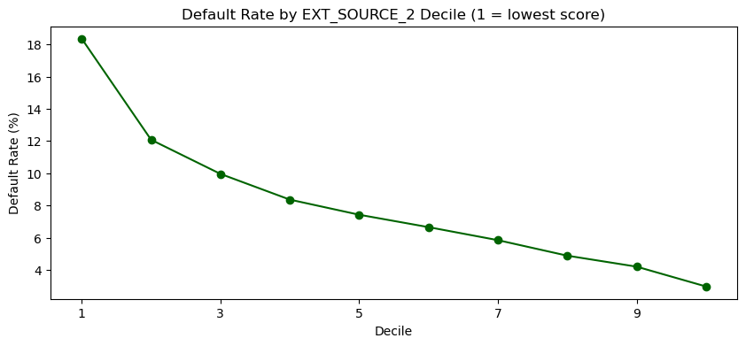
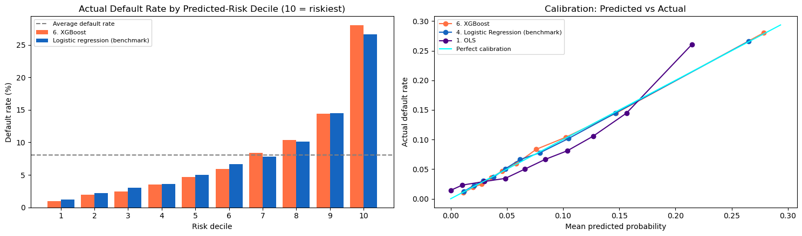

# Home Credit: Who Should Get the Loan?

**Ranking loan applicants by default risk to focus a lender's review effort**

*Queen's University, Smith School of Business, MMA 867 Predictive Modelling | Team project, October 2026*
Team Agnes: Jason Anyimadu, Carter Chen, Hodane Abdi, Moji Khorashahi, Mutasha Lin

## The business question

A lender receives thousands of loan applications and cannot review each one in depth. Can the information on the application alone identify the applicants most likely to have payment difficulty, so that review time goes where it matters? And which model should the lender trust to do it?

## What we found

- **Review the riskiest 20%, catch over half the problem loans.** Flagging the top fifth of applicants by risk captures about 53% of all future defaults (2,610 of 4,965 in the held-out test group). About 21% of flagged applicants do default, roughly 2.6 times the average rate of 8%.
- **The most accurate model has only a small edge.** XGBoost, a machine-learning model, ranks risk best. Over the standard logistic regression used in credit scoring, it catches fewer than one extra defaulter per 100 applicants flagged.
- **So we recommend the explainable option.** A banded logistic scorecard recovers about a quarter of that edge while keeping every decision traceable to specific reasons. That matters for regulators, customers, and internal governance. XGBoost is kept as a challenger model to monitor what the scorecard leaves behind.
- **The default setting is the wrong one.** Using the usual 50% probability cut-off, the best model flags almost no one (it catches 2% of defaults). The cut-off should be set from the lender's actual margin and loss figures, not left at the default.
- **Credit scores and age drive risk.** The three external credit scores are the strongest signals: default falls from about 18% in the lowest score group to about 3% in the highest. Applicants aged 20 to 25 default at about 12%, against under 4% for ages 65 to 70.

*Left: actual default rate in each risk group, from lowest risk (1) to highest (10). Right: predicted risk compared with actual outcomes. Closer to the diagonal line means the probabilities can be trusted.*

## Recommendations to the lender

1. Use the explainable scorecard as the decision model. Send the riskiest 20% to manual review and fast-track the lowest-risk groups.
2. Run XGBoost alongside it as a challenger, and switch only if the extra defaults caught outweigh the cost of explaining and governing a less transparent model.
3. Set the review cut-off from business costs: flag an applicant when predicted risk exceeds margin ÷ (loss given default + margin).
4. Remove gender before deployment (it costs a negligible amount of accuracy), audit approval rates across groups for indirect effects, and review the use of age with legal counsel.
5. Track performance on new applicants every quarter and retrain when it slips.

## Limits to keep in mind

- Results use the main application table only. Adding credit-history tables (previous loans, repayment records) could change the size of the gap between models.
- Results are from one time period. They should be validated on later applicants before deployment.
- Flagged applicants should be reviewed, not declined automatically. The best model still flags about 3.7 good borrowers for every defaulter it catches.

## How the work was done

Six models were compared on 307,511 past applicants (8.07% defaulted) using a 20% test group that no model saw until the final comparison. Models were judged on how well they rank risk, whether their probabilities match reality, how stable they are, and what they would mean for a review team. Differences between models were tested by resampling, not assumed.

## What is in this folder

| Path | Contents |
|---|---|
| `notebooks/Home_Credit_Default_Risk_Model.ipynb` | Full analysis: data checks, feature engineering, six models, validation, business view |
| `images/` | Charts used in this page |
| `requirements.txt` | Python packages used |

## Re-running the notebook

The data files are too large to host here and are covered by the competition's terms, so they are not included. To re-run:

1. Download `application_train.csv` and `application_test.csv` from the [Kaggle Home Credit Default Risk competition](https://www.kaggle.com/competitions/home-credit-default-risk/data).
2. Place them in a folder named `home-credit-default-risk` next to the notebook.
3. `pip install -r requirements.txt`, then open the notebook in Jupyter.

Data source: Home Credit Group via Kaggle. Course project for educational purposes.
