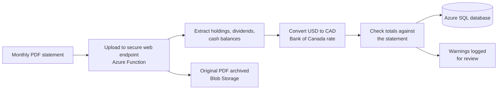

# Investment Fund: Brokerage Data Automation

**Turning monthly brokerage PDF statements into a clean, checked, reporting-ready database**

*Built for an investment fund's Risk & Data team | Built by Hodane Abdi*

> Code only. No statements, account numbers, credentials or fund data are included in this repository.

## The business problem

The fund receives a monthly PDF statement from its broker. The holdings, dividends and cash balances inside are the raw material for risk and performance reporting, but PDFs cannot be queried. Copying figures out by hand is slow, easy to get wrong, and hard to audit. Part of the portfolio is held in US dollars, so every figure also has to be converted to Canadian dollars consistently, or reported totals will not match from one month to the next.

## What the pipeline does

1. **Upload.** A statement is sent to a secured web endpoint. The original PDF is archived so every number can be traced back to its source.
2. **Extract.** Holdings (Canadian and US), dividends and distributions, and opening and closing cash are read from the PDF and stored in separate, consistently named tables.
3. **Convert currency.** US-dollar figures are converted to CAD using the official Bank of Canada rate on or before the statement date, so month-ends that fall on a weekend or holiday are handled the same way every time. If the Bank of Canada service is unreachable, the broker's printed rate is used and a warning is recorded, so a stand-in rate is never used silently.
4. **Check the work.** The parsed holdings are added up and compared with the totals printed on the statement. A mismatch marks the statement as needing review instead of loading it as if it were correct.
5. **Load without duplicates.** Each statement is identified by account and month. Re-uploading a statement replaces the earlier load, and a failed load is rolled back completely, so the database never holds half a statement.

## What it delivered

- **Repeatable and auditable.** One upload replaces manual re-keying, and every figure links back to the archived PDF, the FX rate used and its date.
- **Errors surface instead of hiding.** Backfilling 118 historical monthly statements (2016 to 2026) into the earlier SQLite version of the database, 107 reconciled to the statement totals automatically. The other 11 were flagged for review by the check rather than loaded silently.
- **Reporting-ready.** The tables are designed to feed reporting tools such as Power BI, with Canadian and US holdings kept separate but in sync.

## Known gaps, stated openly

- **Reinvested dividends.** Dividend reinvestment lines are recorded, but their dollar amounts are left blank and flagged, so that income is excluded from dividend totals until the reinvestment price and share fields are added. This was agreed with the team lead as a known limit of the first version.
- **Statement layout.** The extraction depends on the broker's current PDF layout. If the layout changes, the totals check is designed to catch it, which is how the 11 flagged statements above were identified.

## Design decisions worth noting

- **Moved from SQLite to Azure SQL.** Testing showed that the storage attached to a serverless Azure Function app does not reliably persist data between runs, so a local database file was not safe. The data now lives in Azure SQL Database, and a migration script moved the existing history across.
- **No native database drivers.** The pipeline uses a pure-Python SQL driver so the cloud function needs no extra installation steps.
- **Secrets stay out of the code.** Connection details are read from environment settings, and the repository ships only a placeholder settings file.

## What is in this folder

| Path | Purpose |
|---|---|
| `function_app.py` | The web endpoint: validates the upload, runs the pipeline, archives the PDF, returns a summary |
| `parser.py` | Reads holdings, dividends and cash balances out of the PDF |
| `fx.py` | Bank of Canada exchange rates, with the on-or-before-date rule and a flagged fallback |
| `build_pipeline.py` | Database schema, de-duplication, currency conversion, totals check, batch loader |
| `migrate_sqlite_to_azuresql.py` | One-time migration of the earlier SQLite history into Azure SQL |
| `scripts/` | Small diagnostic checks (recent loads, months on file) |
| `local.settings.sample.json` | Placeholder settings. Copy to `local.settings.json` and fill in your own values |
| `requirements.txt`, `host.json` | Dependencies and Azure Functions configuration |

## Running it

1. Create a Python 3.11 environment and `pip install -r requirements.txt`.
2. Copy `local.settings.sample.json` to `local.settings.json` and add your Azure SQL details. That file is git-ignored.
3. Batch load a folder of statements: `python build_pipeline.py <folder>` (add `--reset` for a full rebuild), or run the endpoint locally with Azure Functions Core Tools (`func start`) and `POST` a PDF to `/api/upload-statement`.

Statements are not included because they are the fund's records.
