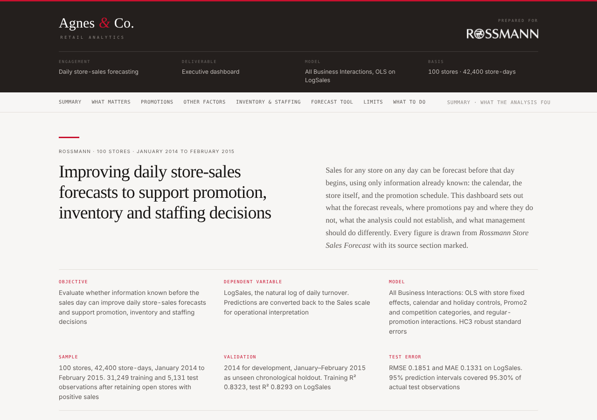

# Rossmann: Forecasting Daily Store Sales

**Using what a retailer already knows before the day starts to plan promotions, inventory and staffing**

*Queen's University, Smith School of Business, MMA 860 | Team project, August 2026*
Team Agnes

> Course case study built on the public Rossmann dataset from Kaggle. It is not client work and was not prepared for or by Rossmann.

## The business question

A drugstore chain has to decide how much stock to hold and how many staff to schedule for every store, every day. Can information known in advance (the calendar, the store's own profile, and the promotion schedule) forecast daily sales well enough to guide those decisions? And where do promotions actually pay?

## What we found

- **Each store needs its own forecast.** The biggest improvement in accuracy came from letting every store have its own baseline sales level. Location, customer mix and local traffic make stores differ persistently, so one chain-wide forecast leaves accuracy on the table.
- **The forecast is reliable on unseen data.** Tested on January and February 2015, a period the model never saw, it explained about 83% of the variation in daily sales, the same as on the 2014 data it was built on. A typical store-day forecast is off by roughly 18%. The 95% planning ranges contained 95.3% of actual results, so the ranges can be used as stated.
- **Promotions work, but not equally.** In the model's reference case, a regular promotion lifts sales by about 79% on a Monday, falling to about 37% by Friday. Response also differs by store type, product assortment and school holidays. Promotional stock and staffing should follow the store and the day, not a single chain-wide assumption.
- **The second promotion programme (Promo2) is not a guaranteed sales lift.** In the raw data, sales during active Promo2 periods were about 2.8% lower. It does change how stores respond to regular promotions, so it helps forecasting, but it should not be treated as automatic growth.
- **Competitor distance alone did not explain sales.** Once store differences were accounted for, distance to the nearest competitor added little. That does not mean competition is unimportant; distance does not capture competitor size, pricing or local traffic.

## Recommendations

1. Use store-specific forecasts for inventory and staffing, with the planning ranges for safety stock.
2. Tailor promotional inventory and staffing by weekday, store type and assortment.
3. Evaluate Promo2 on profit, not sales alone.
4. Next phase: add pricing, discount depth, promotion cost, stock-outs and margin data, so the forecast can move from predicting demand to managing it.

## Limits to keep in mind

- The model is a decision-support tool. It does not include price, discount depth, promotion cost or inventory availability, so it cannot show whether a promotion was profitable.
- The analysis covers 100 stores with complete daily records (42,400 store-days, January 2014 to February 2015), not the full 1,115-store chain.
- Prediction ranges at the 99% level covered 97.7% of outcomes, so a few unusually high or low days are still understated.

## How the work was done

Daily sales were modelled with a regression that includes a separate baseline for each store, calendar and holiday effects, promotion programmes, competition, and how promotions interact with weekday and store type. 2014 was used to build the model and January to February 2015 to test it. Diagnostics checked whether the model's assumptions held, and robust standard errors were used where they did not. Business hypotheses (for example, "does promotion response differ by weekday?") were tested formally.

## Tools used

- **Language and environment:** Python, Jupyter Notebook
- **Data handling:** pandas, NumPy
- **Modelling and testing:** statsmodels (regression with store-level effects, robust standard errors, heteroskedasticity and Wald tests), scikit-learn (accuracy metrics)
- **Charts:** matplotlib
- **Dashboard:** standalone HTML and CSS page for executives

## What is in this folder

| Path | Contents |
|---|---|
| `dashboard/Executive_Dashboard.pdf` | Executive dashboard, printable version |
| `dashboard/Executive_Dashboard.html` | Interactive dashboard (download and open in a browser) |
| `notebooks/Rossmann_Sales_Forecast.ipynb` | Full analysis code: data preparation, model, diagnostics, tests, forecast validation |
| `requirements.txt` | Python packages used |

## Re-running the notebook

The notebook reads `Rossmann_100_Complete_Stores.csv`, a 100-store extract of the Kaggle data (daily sales file joined to the store profile file). Kaggle's competition terms do not permit redistributing the data, so it is not included. Download `train.csv` and `store.csv` from the [Kaggle Rossmann Store Sales competition](https://www.kaggle.com/c/rossmann-store-sales/data) to rebuild it, then `pip install -r requirements.txt` and open the notebook in Jupyter.
